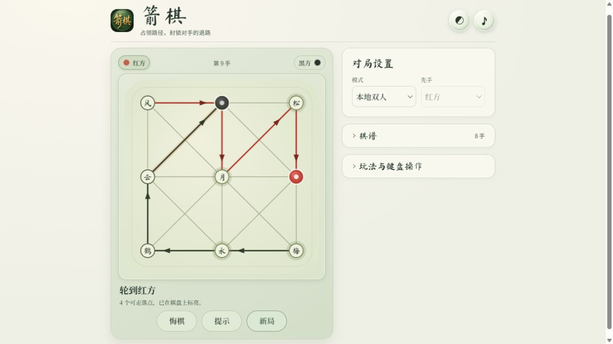
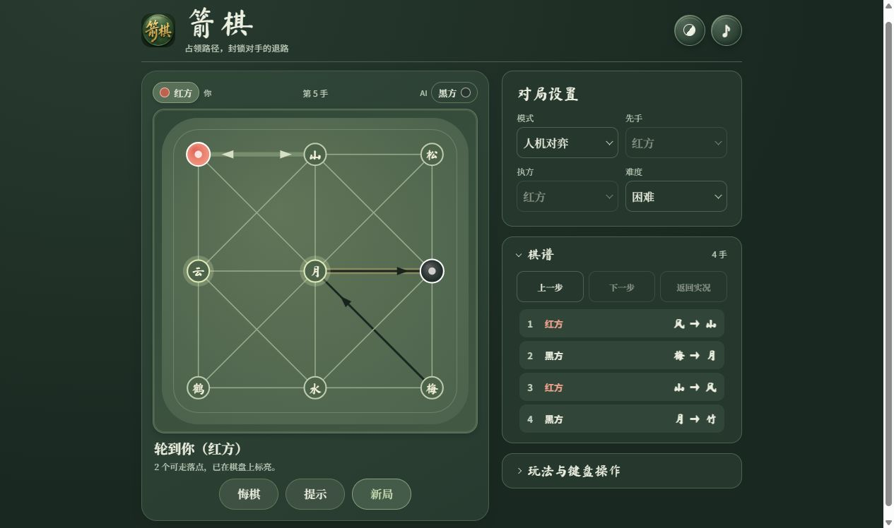

# 箭棋 · Arrow Chess

箭棋是一款双人路径占领棋。双方各一枚棋子，在九个点之间走棋。走过的路径归你所有，封住对手的退路就能取胜。

**[在线试玩箭棋](https://foreverfine77.github.io/ArrowChess/)**

## 离线游玩

1. 在 GitHub 仓库点击 **Code → Download ZIP**，然后解压整个目录。
2. 双击 `web/index.html`。Windows 也可以双击根目录的 `启动箭棋.cmd`。
3. 选择本地双人或人机对弈，再依次放置红、黑棋子。人机模式有简单、中等、困难三档。

打开后即可离线游玩。用鼠标或触屏点选落点，也可以用方向键选点，按回车或空格确认。顶栏可切换主题和音效，展开棋谱可以回放走法。

## 游戏截图

**竹青主题 · 本地双人**



**墨夜主题 · 人机对弈**



## 规则

- 红方先摆，黑方后摆。双方把棋子放在不同的点上，随后由设置中的先手方开始走棋。
- 每回合沿横、竖或斜向的路径移动到相邻空点。
- 首次经过一条路径即占领它。占领方可以沿该路径反向返回一次，随后路径关闭。
- 轮到一方无路可走时，对方获胜。

## 开发与构建

```bash
npm ci
npm run dev
```

开发服务器默认运行在 [localhost:5174](http://localhost:5174/)。

```bash
npm test
npm run typecheck
npm run build:web
```

`build:web` 会更新离线入口使用的 `web/game.js`，并生成 `dist/web/`。部署时上传整个 `dist/web/` 目录。

共享规则和 AI 位于 [`core/`](core/)，网页与棋盘渲染位于 [`web/`](web/)。微信开发者工具使用单独的本地 `miniprogram/` 工程。存在该工程时，项目检查也会覆盖微信小游戏。
